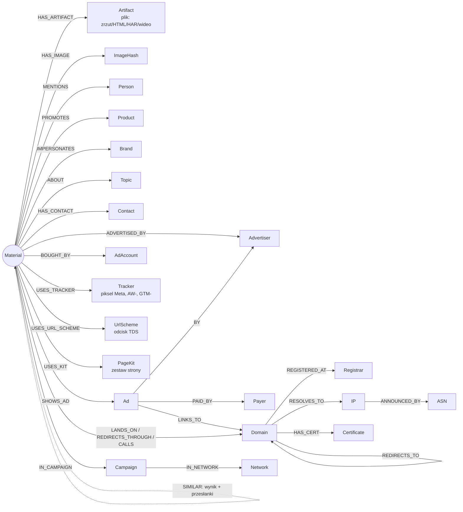

# 13. Baza grafowa (Neo4j)

Baza, w której wszystkie zebrane ślady (reklamy, domeny, piksele, osoby, płatnicy…) są kropkami połączonymi kreskami.
Działa lokalnie (Docker) i na **wspólnym serwerze zespołu (Railway)** z kompletem danych.

## Co zostało zrobione

1. **Schemat bazy** (`code/graph/schema.cypher`): 22 rodzaje kropek, ograniczenia unikalności, indeks pełnotekstowy
   na tekstach materiałów i dwa indeksy wektorowe pod embeddingi (gotowe na model, jeszcze puste).
2. **Ładowanie danych** (`code/graph/load.py`), jedna komenda:
   - **wszystkie reklamy z Meta Ad Library** (`data/meta/ads.jsonl`, 97 447 reklam, ~2 min): reklama, strona-reklamodawca,
     płatnik, domena z linku, słowo kluczowe, którym ją znaleźliśmy, osoby z bazy `osoby.txt` wykryte w treści;
     oznaczenie, czy Meta usunęła reklamę albo zablokowała konto;
   - **10 przypadków NASK** (z indeksu `fejki demo build`): pliki, obrazy, osoby, produkty, podrabiane portale, piksele,
     domeny, przekierowania, zestawy stron, schematy adresów, reklamodawcy ze zrzutów;
   - **infrastruktura domen** (bierne źródła: DNS, RDAP, crt.sh): rejestrator, data rejestracji, IP, ASN, certyfikaty;
   - **wynik porównania** z obecnego silnika (ten sam co w aplikacji): podobieństwa `SIMILAR` z wynikiem i przesłankami,
     kampanie (próg 0,7) i sieci operatorów.
3. **Serwer zespołu na Railway** (projekt `kolektor-fejkow-neo4j`): Neo4j 5.26 Community na stałym dysku, z kompletem
   danych powyżej. Dostęp przez przeglądarkę (https) i z Pythona.
4. **Lokalna baza w Dockerze** (`code/docker-compose.yml`) i **fikcyjny przykład** do nauki schematu (`code/graph/example.cypher`).

### Co wyszło od razu na prawdziwych danych

- Sieć **S1 = przypadki 1, 2, 3, 48, 61**: kampanie K1 = {1, 2} i K2 = {48, 61} (te same wyniki co w aplikacji).
- Domeny civicdaybook.live i acrosscommunities.live: ten sam rejestrator (Dynadot), zarejestrowane w odstępie minuty.
- **NASK ↔ Meta:** przypadek 10 ma tego samego reklamodawcę („Sweet Bonanza”) co 21 reklam w bibliotece Mety;
  48 łączy się z 5 reklamami konta „Sharon Coleman”, 47 z 2 reklamami „Evelyn Johnson”.
- **Ukryty operator w Mecie:** płatnicy „Eastmoor Media” i „Harborline Distribution” finansują **te same 11 stron**
  kasynowych i prowadzą na tę samą domenę (online-game.com).
- **Podrobione litery:** część stron ma nazwy z cyrylicą udającą łacinkę („GоІdеn Gеm”); oznaczone jako `mixed_script`.

## Instrukcja 1: serwer zespołu (najprościej, nic nie instalujesz)

1. Wejdź na **https://neo4j-production-34a89d16.up.railway.app**
2. W oknie logowania w „Connection URL” wpisz: `neo4j+s://neo4j-production-6d8b343a.up.railway.app:443`
3. Użytkownik `neo4j`, hasło od osoby, która stawiała serwer (u niej w `code/.env` jako `RAILWAY_NEO4J_PASSWORD`).
   **Hasła nie wklejamy do repo ani na publiczne kanały.**
4. Wklej jedno z gotowych zapytań poniżej i kliknij **Run**.

Obsługa podglądu:
- **jeden klik w kropkę**: szczegóły po prawej;
- **podwójny klik**: dorysowuje wszystkie jej połączenia (tak „chodzi się” po grafie);
- zawsze zaczynaj od konkretnej rzeczy (przypadek, płatnik, domena). **Nie** wpisuj `MATCH (n) RETURN n`:
  w bazie jest ~130 tys. kropek i przeglądarka się zatka;
- zwracaj `p` (całą ścieżkę), a nie same kropki: `RETURN n` pokazuje kropki bez kresek.

### Gotowe zapytania (działają na serwerze i lokalnie po `load.py all`)

```cypher
// 1. sieć oszustów S1: przypadki NASK z kampaniami
MATCH p=(m:Material)-[:IN_CAMPAIGN]->(:Campaign)-[:IN_NETWORK]->(:Network {id:'S1'}) RETURN p

// 2. co łączy przypadki 1 i 2 (wspólne kropki = przesłanki)
MATCH p=(a:Material {id:'1'})-->(slad)<--(b:Material {id:'2'}) RETURN p

// 3. przesłanki podobieństwa jako tabela
MATCH (a:Material)-[s:SIMILAR]->(b:Material) RETURN a.id, b.id, s.score, s.relation, s.reasons ORDER BY s.score DESC

// 4. przypadki NASK, które mają wspólnego reklamodawcę z reklamami z Mety
MATCH p=(m:Material)-[:ADVERTISED_BY]->(adv)<-[:BY]-(a:Ad) RETURN p

// 5. dwóch „różnych” płatników z tymi samymi stronami i domeną
MATCH p=(py:Payer)<-[:PAID_BY]-(a:Ad)-[:BY|LINKS_TO]->(x)
WHERE py.name IN ['Eastmoor Media','Harborline Distribution'] RETURN p

// 6. płatnicy, za którymi stoi najwięcej stron z reklamami oznaczonymi przez Metę (kandydaci na sieci oszustów)
MATCH (py:Payer)<-[:PAID_BY]-(a:Ad)-[:BY]->(adv:Advertiser)
WHERE a.meta_flag IS NOT NULL AND size(py.name) > 3 AND py.name <> 'Advertiser'
RETURN py.name, count(DISTINCT adv) AS stron ORDER BY stron DESC LIMIT 20

// 7. domeny przypadków NASK: rejestrator i data rejestracji
MATCH (m:Material)-[:LANDS_ON]->(d:Domain) OPTIONAL MATCH (d)-[:REGISTERED_AT]->(r)
RETURN m.id, d.name, d.registered, r.name ORDER BY d.registered

// 8. które ślady są najczęstsze (im częstszy, tym mniej mówi)
MATCH (x)<--(m:Material) RETURN labels(x)[0] AS slad, x.name, count(m) AS n ORDER BY n DESC LIMIT 10
```

Uwaga do zapytania 6: bez warunku `meta_flag` na górze wychodzą legalni wielcy reklamodawcy (aplikacje z serialami).
Są też płatnicy-śmieci („EU”, „1”, „Advertiser”), bo Meta pozwala wpisać byle co; warunek `size > 3` odcina część z nich.

## Instrukcja 2: własna baza na laptopie

Wymagania: Docker, Python 3.11+, dane w `data/` (zob. [archiwum/02_DANE.md](archiwum/02_DANE.md)).

```bash
cd code
pip install -e ".[dev,graph]"                 # sterownik neo4j (extra `graph`)
cp .env.example .env                          # jeśli jeszcze nie masz; ustaw NEO4J_PASSWORD (dowolne hasło)
docker compose up -d                          # Neo4j: http://localhost:7474, bolt://localhost:7687
.venv/bin/fejki demo build --infra            # cechy przypadków NASK + bierne dane o domenach (~1 min)
.venv/bin/python graph/load.py all            # schemat + Meta (~2 min) + NASK z kampaniami
```

Podgląd: http://localhost:7474, login `neo4j` + hasło z `code/.env`.

Inne warianty:

```bash
.venv/bin/python graph/load.py schema                               # tylko schemat
.venv/bin/python graph/load.py meta --payer "alex alex" --limit 80  # tylko próbka z Mety
.venv/bin/python graph/load.py nask                                 # odśwież przypadki po nowym `demo build`
```

Kolejność ma znaczenie: **najpierw Meta, potem NASK**, bo przypadki dopinają się do reklamodawców, reklam i domen,
które już są w bazie. Ładowanie można powtarzać (wszystko idzie przez `MERGE`, nic się nie dubluje).

Fikcyjny przykład (reklamy A, B, C, D, domeny `.example`) do nauki schematu, **tylko lokalnie**:

```bash
set -a; . ./.env; set +a
docker exec fejki-neo4j cypher-shell -u neo4j -p "$NEO4J_PASSWORD" -f /graph/example.cypher
# podgląd: MATCH p=(n)-[]-() WHERE n.demo RETURN p      usunięcie: MATCH (n) WHERE n.demo DETACH DELETE n
```

## Instrukcja 3: ładowanie na serwer zespołu

Te same komendy, tylko z adresem i hasłem serwera:

```bash
cd code
NEO4J_URI=bolt://gondola.proxy.rlwy.net:38398 NEO4J_PASSWORD=<hasło serwera> .venv/bin/python graph/load.py nask
```

| Do czego | Adres |
|---|---|
| podgląd w przeglądarce | https://neo4j-production-34a89d16.up.railway.app |
| ↳ „Connection URL” w oknie logowania | `neo4j+s://neo4j-production-6d8b343a.up.railway.app:443` |
| Python / `load.py` / cypher-shell | `bolt://gondola.proxy.rlwy.net:38398` |

Połączenie `bolt://` (Python) nie jest szyfrowane; podgląd w przeglądarce idzie przez https.

## Próbka Mety (kryterium S1)

Pełna Meta to 97 tys. reklam i ładuje się długo. Do pracy lokalnej i do ewaluacji służy mniejsza próbka z jawną regułą:

```bash
cd code
.venv/bin/python graph/sample.py                                   # ~2 s, zawsze ten sam wynik (ziarno 1)
.venv/bin/python graph/load.py meta --file ../data/meta/sample_s1.jsonl
```

Reguła w pięciu punktach:

1. **Losujemy twórców, nie reklamy.** Twórca (strona, `page_id`) wchodzi z kompletem reklam, najwyżej 20 (`--cap`).
   Inaczej reklamy jednego twórcy rozjechałyby się po próbce i nie dałoby się sprawdzić, czy umiemy go odtworzyć.
2. **Grupa scam** = twórcy z co najmniej jedną reklamą zdjętą przez Metę. Wchodzą wszyscy „mieszani” (653: część reklam
   zdjęta, część nie; tylko u nich zostaje tekst przy znanej etykiecie) i losowo dobrani „w pełni zdjęci” do 1000 twórców.
3. **Grupa kontrolna** = 1000 twórców bez żadnej zdjętej reklamy, dobranych **z tych samych tematów** (to samo zapytanie,
   którym ich znaleźliśmy). Bez tego model nauczyłby się „kasyno = scam”, a nie rozpoznawania twórcy.
   W tematach, gdzie czystych twórców prawie nie ma (Sweet Bonanza, darmowe spiny), brakującą kontrolę dobieramy z innych tematów.
4. **Kotwice NASK:** zawsze wchodzą strony „Sharon Coleman” i „Evelyn Johnson”, powiązane z przypadkami 48 i 47.
5. **Ziarno 1:** każdy w zespole dostaje identyczny plik.

Wynik: 2002 twórców, 14 936 reklam, z tego 5018 zdjętych. Lista twórców z powodem wyboru i rozkład tematów zapisuje się
w `code/artifacts/samples/sample_s1.json`. Podział na trening/test robi dalej `graph/subjects.py` (po podmiotach, nie po reklamach).
To kryterium robocze: osoba od ewaluacji może je zmienić, wtedy nowa wersja dostaje nową nazwę (S2…), a S1 zostaje do porównań.

## Twórca (węzeł `Creator`)

```bash
cd code
.venv/bin/python graph/creators.py build                                   # ~10 s na pełnej Mecie, idempotentne
.venv/bin/python graph/creators.py diff "Sharon Coleman" "Evelyn Johnson"   # co odróżnia twórcę A od B
```

**Kto to jest twórca.** Reklamy wpadają do jednego twórcy, gdy łączy je strona, płatnik, domena albo identyczny tekst.
Przykład: „Sharon Coleman”, „Cynthia Foster” i „Margaret Reynolds” to trzy strony, ale płaci za nie ten sam „Christian Russell”,
więc to jeden twórca. Ślad, który ma ponad 100 reklam (płatnik „Advertiser”, youtube.com), jest za pospolity i nie skleja.
Strona skleja zawsze: duża strona to jeden twórca, nie „hub”.

**Etykieta scam przechodzi z twórcy na jego reklamy:**

| twórca | warunek | jego niezdjęte reklamy |
|---|---|---|
| `scam` | Meta zdjęła co najmniej połowę jego reklam | `scam`, źródło `twórca` |
| `podejrzany` | zdjęła część, mniej niż połowę | `podejrzany`, źródło `twórca` (do sprawdzenia) |
| `brak sygnału` | nic nie zdjęto | `brak sygnału` (to NIE znaczy „uczciwy”) |

Próg połowy jest po to, żeby jedna zdjęta reklama nie oznaczyła 3000 reklam dużego wydawcy seriali jako scam.
Przypadek NASK, który wskazuje stronę z Mety, dostaje krawędź `CREATED_BY` do jej twórcy (dziś: 10, 47, 48).

Na pełnej Mecie: 9709 twórców, 1571 scam, 302 podejrzanych; 1867 reklam, których Meta nie zdjęła, dostało `scam` po twórcy.
Gotowe zapytania do Neo4j Browser (obrazek twórcy, A vs B, profil, propagacja, siatki stron): `code/graph/creator_queries.cypher`.

## Syntetyka w grafie

```bash
.venv/bin/python graph/load.py synth      # generuje data/synth (jeśli nie ma), buduje indeks i ładuje
```

42 przypadki (6 operatorów, 36 oszustw, 6 „legalnych” negatywów) jako `Material {dataset: 'synth'}` z prawdą w
`truth_campaign`, `truth_operator`, `truth_kind`. Kampanie i sieci mają prefiks `synth:`, reklamodawcy klucz `synth:name:…`,
domeny są `.example`/`.test`, więc nic nie skleja się z prawdziwymi danymi (wspólne są tylko osoby wymienione w tekście).
Porównanie z prawdą: `MATCH (m:Material {dataset:'synth'})-[:IN_CAMPAIGN]->()-[:IN_NETWORK]->(n) RETURN n.id, collect(DISTINCT m.truth_operator)`.
Dziś: 4 z 6 operatorów odtworzone dokładnie; O1+O2 sklejone (celowo trudny przypadek: wspólny zestaw strony),
a 6 negatywów wpada w jedną sieć (fałszywe połączenie, do poprawy w silniku).

## Dodawanie nowych materiałów i scraper (`graph/scrape.py`)

```bash
cd code
.venv/bin/python graph/scrape.py seed                                    # raz: galeria startowa z próbki S1 (~1 min)
.venv/bin/python graph/scrape.py add ../data/meta/nowe.jsonl             # reklamy Meta z pliku JSONL
.venv/bin/python graph/scrape.py add ../data/dane/do_udostępnienia/48    # folder przypadku
.venv/bin/python graph/scrape.py add --text "treść reklamy" --url "https://adres/..."   # adres NIE jest odwiedzany
.venv/bin/python graph/scrape.py watch ../data/meta/ads.jsonl --every-min 60          # scraper: co godzinę nowe linie
```

Co się dzieje z jednym materiałem:

1. **Silnik kolegi (`embsim.api`)** porównuje go z galerią i mówi: *znana kampania*, *znany operator, nowa kampania*
   albo *nowy wzorzec*, z top-5 podobnych i powodami (treść, brzmienie tekstu, domena, piksel…). Progi są zamrożone
   w `code/config/embsim/`.
2. **Graf dokłada dokładne zgodności:** ta sama strona, płatnik, domena albo identyczny tekst co znany twórca.
   To mocniejszy dowód niż próg, więc wygrywa.
3. **Twórca:** dokładna zgodność → ten twórca; inaczej, gdy silnik mówi „znana kampania / znany operator” → twórca
   najbliższego materiału; inaczej nowy twórca.
4. **Zapis w grafie:** reklama albo materiał z tymi samymi krawędziami co przy zwykłym ładowaniu, `CREATED_BY` do twórcy,
   `SIMILAR_TO` do top-5 (wynik i powody na krawędzi), decyzja na węźle: `verdict` i `verdict_text` (wyjaśnienie po polsku).

Ponowne dodanie tego samego niczego nie dubluje. `watch` pamięta, ile linii pliku już przerobił
(`code/artifacts/scrape/watch_state.json`), a raport z każdego przebiegu dopisuje do `watch_report.jsonl`.
Token do Meta Ad Library jeszcze nie jest wpięty, więc scraper czyta plik JSONL; kiedy token będzie, pobieranie
(`fejki/sources/meta_library.py`) dopisuje nowe reklamy do `data/meta/ads.jsonl`, a `watch` je podchwyci.

Podgląd w Neo4j Browser:

```
MATCH p = (n)-[:SIMILAR_TO|CREATED_BY]->() WHERE n.verdict IS NOT NULL RETURN p
```

Sprawdzone na prawdziwych danych: 10 nowych reklam spoza próbki dostało twórcę (w większości po stronie albo płatniku),
przypadek NASK 48 trafił do twórcy „Sharon Coleman” po nazwie strony, wklejony tekst bez śladów dostał „nowy wzorzec”.
Czas: ok. 0,2–6 s na reklamę (porównanie z całą galerią 15 tys.), folder z OCR ok. 25 s.

Ograniczenia:
- galeria jest w `code/artifacts/` (poza gitem): każdy robi `seed` u siebie; po `creators.py build` zrób `seed` jeszcze raz,
  bo grupy w galerii to id twórców;
- silnik liczy pospolite domeny (np. instagram.com) jako mocny wspólny ślad; to do poprawy w `embsim` (lista hubów);
- progi są dobrane na syntetyce; na prawdziwych danych decyzja silnika jest orientacyjna, dokładne zgodności z grafu nie.

## Ruch sieciowy (przekierowania, hosty trzecie)

Graf liczy kanał ruchu **tak samo jak silnik `embsim`** (format: [15_FORMAT_KANALU_RUCHU.md](15_FORMAT_KANALU_RUCHU.md)),
więc pokazuje dokładnie to, co widzi wynik podobieństwa:

| w grafie | skąd | przykład |
|---|---|---|
| `(:Material)-[:CALLS]->(:Domain)` | domeny z HAR (dwa ostatnie człony), bez domen lądowania | `jsdelivr.net` |
| `(:Material)-[:USES_KIT]->(:PageKit)` | katalog zasobu: pierwsze dwa segmenty ścieżki | `/_cdn/production` |
| `(:Material)-[:USES_URL_SCHEME]->(:UrlScheme)` | posortowane nazwy parametrów adresu | `utm_campaign,utm_content,…` |
| `(:Material)-[:USES_TRACKER]->(:Tracker)` | piksele i tagi z HTML (+ te, które znalazł stary ekstraktor) | `meta:1330594163214458` |
| `(:Material)-[:REDIRECTS_THROUGH {hop, src, status}]->(:Domain)` | kolejne przekierowania z HAR (3xx, w kolejności czasu) | `1: google.com → google.com (302)` |
| `Material.n_requests` | liczba żądań w HAR | `71` |

**Huby:** ślady pospolite (CDN, trackery, google.com) dostają `hub = true`: są w ponad 100 reklamach Mety, w obu zbiorach
(NASK i syntetyka) albo w co najmniej 30% materiałów dużego zbioru. Nie są kasowane. Zestaw strony i schemat adresu
sieci S1 hubami **nie** są: to dowód, a nie szum.

**Zabezpieczenie w `add`:** jeśli silnik łączy nowy materiał ze znanym tylko przez huby (np. NASK 61 dostał „znana kampania”
z wynikiem 0,95 za samo wspólne `google.com`), graf tego nie przyjmuje: materiał dostaje „nowy wzorzec” z wyjaśnieniem.

Eksport dla silnika (wersja 2 kanału, z krokami przekierowań i liczbą żądań):

```bash
.venv/bin/python graph/load.py traffic     # -> code/artifacts/traffic/traffic.jsonl
```

## Widok w demo: zakładka „🧩 Klastry w grafie”

```bash
cd code && .venv/bin/fejki demo app        # http://localhost:8501, zakładka „Klastry w grafie”
```

Zakładka czyta Neo4j z `code/.env` (lokalna baza albo serwer zespołu: ustaw `NEO4J_URI` i `NEO4J_PASSWORD`).
Bez bazy pokazuje komunikat, a reszta demo działa dalej. Zasada: **jeden klaster naraz i tylko to, co go skleja**;
huby (google.com, CDN) są pominięte. Rysunek ma stały układ (bez „pływających kulek”), każdy owal mówi, czym jest ślad.

| widok | co widać |
|---|---|
| Twórcy (Meta) | filtr etykiety i wyszukiwarka → karta: liczby (reklamy, zdjęte, strony, płatnicy, okres), rysunek „strony ↔ płatnik / domena / identyczny tekst”, tabela przesłanek, przypadki NASK tego twórcy, reklamy z linkiem do Ad Library, karta do pobrania (Markdown) i zapytanie do Neo4j Browser |
| Sieci i kampanie (NASK, syntetyka, nowe) | lista sieci → rysunek „materiały ↔ wspólne ślady” (ślady tego samego rodzaju łączące te same materiały są jednym owalem, np. „11 × ten sam obraz”), tabela wspólnych śladów, pary z wynikiem i przesłankami |
| Nowe materiały (add / scraper) | co dodano, jaka decyzja, do którego twórcy i dlaczego, pełne wyjaśnienie po polsku |

To samo z wiersza poleceń (np. do prezentacji): `graph/clusters.py creator "Sharon Coleman"`, `graph/clusters.py group S1`.

## Wektory tekstów reklam (kolejność kroków)

```bash
.venv/bin/python graph/load.py meta                          # zapisuje też Ad.text_hash
.venv/bin/python graph/subjects.py split --write-graph       # Ad.fold, Ad.subject (podział bez przecieków)
.venv/bin/python graph/load.py export                        # artifacts/meta/ad_texts.jsonl + ad_meta.jsonl
.venv/bin/python -m embsim.batch artifacts/meta/ad_texts.jsonl artifacts/meta/qwen_ads
.venv/bin/python graph/load_embeddings.py artifacts/meta/qwen_ads --dim 1024
```

`text_hash` to pierwsze 12 znaków SHA-1 tekstu „tytuł + treść”, liczone tą samą funkcją co w `embsim.api` (`case_from_meta_ad`),
więc `add` znajduje w grafie identyczny tekst. Reklamy zdjęte przez Metę nie mają tekstu, więc nie mają też odcisku.
Uwaga: `embsim/eda.py` liczy swój odcisk z samej treści; to tylko statystyka, z grafem się nie łączy.

## Dane organizatora na serwerze

Na serwerze są **teksty i cechy** wyciągnięte z danych organizatora (bez plików HTML/HAR/zrzutów). Zbiór służy tylko
realizacji wyzwania (opis, pkt 8), więc serwer i hasło zostają w zespole. Przed ewentualnym upublicznieniem repo trzeba
usunąć z tego pliku adresy serwera, a po hackathonie usunąć projekt na Railway.

---

## Jak to działa (dla ciekawych)

Każdy ślad, który dwie reklamy mogą mieć **wspólny**, jest osobną kropką (węzłem): domena, piksel Facebooka, osoba,
zestaw strony, schemat adresów… Reklama to kropka połączona kreskami ze swoimi śladami. Jeśli dwie reklamy dotykają
tej samej kropki, mają wspólny ślad, a **ta kropka jest od razu przesłanką** („obie mają piksel 1111…”).
Jury wymaga właśnie tego: powiązania z uzasadnieniem (pkt 3 i 6 opisu wyzwania). Kropka, do której podpięte są setki
reklam (np. popularny polityk), mało mówi; widać to po liczbie jej kresek.



### Węzły

| Grupa | Węzeł | Klucz | Co to jest (przykład) |
|---|---|---|---|
| materiał | `Material` | `id` | jeden incydent: folder od organizatora albo zgłoszenie z UI (przypadek „1”) |
| | `Artifact` | `sha256` | plik materiału; ten sam plik w 2 przypadkach = ta sama kropka (duplikaty wychodzą same) |
| | `ImageHash` | `phash` | odcisk percepcyjny obrazka (te same obrazki w 48 i 61) |
| treść | `Person` | `name` | osoba z bazy referencyjnej `config/osoby.txt` (Rafał Brzoska) |
| | `Product` | `name` | co sprzedają (Metabo RX) |
| | `Brand` | `name` | podrabiany portal / logo (gazeta) |
| | `Topic` | `name` | tematyka z przypadku albo słowo kluczowe wyszukania w Mecie (inwestycje, „Sweet Bonanza”) |
| | `Contact` | `value` | telefon / komunikator ze strony |
| reklama | `Ad` | `id` | reklama z Ad Library albo `ad_id` z adresu w przypadku; ten sam numer = ta sama kropka |
| | `Advertiser` | `key` | strona, która wyświetliła reklamę: `fb:<page_id>` z Mety albo `name:<nazwa>` ze zrzutu |
| | `Payer` | `name` | płatnik z Ad Library; jeden płatnik za wieloma stronami = sygnał sieci |
| | `AdAccount` | `id` | oznaczenie kupującego ruch z adresu (`acc=hk77_tv6_…`) |
| | `Tracker` | `id` | kod śledzący: `meta:<piksel>`, `AW-…`, `GTM-…` (`kind` mówi jaki) |
| strona | `Domain` | `name` | domena rejestrowalna (civicdaybook.live) |
| | `UrlScheme` | `fingerprint` | kształt parametrów adresu = system kierowania ruchu (TDS) |
| | `PageKit` | `prefix` | gotowy zestaw strony (`/_cdn/production/landing-cdn`) |
| infra | `Registrar`, `IP`, `ASN`, `Certificate` | nazwa / adres / numer / serial | Dynadot, Cloudflare, wystawca certyfikatu |
| wynik | `Campaign` | `id` | ten sam przekaz (duplikaty i warianty): K1 |
| | `Network` | `id` | kampanie na wspólnej infrastrukturze = prawdopodobnie ten sam operator: S1 |
| | `Creator` | `id` | twórca: strony, płatnicy i domeny jednego operatora w Mecie (`graph/creators.py`) |
| | `Text` | `hash` | unikalny tekst reklamy z wektorem (`graph/load_embeddings.py`) |

Każdy węzeł ma `name` (podpis w podglądzie). Ważniejsze właściwości: `Ad.meta_flag` (Meta usunęła reklamę albo
zablokowała konto), `Ad.delivery_start/stop`, `Ad.eu_reach`, `Ad.library_url`, `Advertiser.mixed_script`,
`Domain.registered`, `Material.observed_at`, `Material.dataset` (`nask` albo `synth`), `Material.truth_*` (prawda syntetyki),
`Ad.text_hash` (odcisk tekstu), `Ad.label` / `Ad.label_source` i `Creator.label` (etykieta scam, patrz „Twórca”).

### Kreski liczone (a nie odczytane z plików)

- `SIMILAR` (materiał → materiał): `score`, `relation` (duplikat / wariant / wspólna infrastruktura), `channels`, `reasons`.
  Zapisujemy pary od wyniku 0,4.
- `IN_CAMPAIGN`, `IN_NETWORK`: grupowanie z progu 0,7, jak w aplikacji.

### Embeddingi: graf ich nie wyklucza

Wektor tekstu/obrazu materiału ma miejsce w `Material.embedding`, wektor pojedynczego pliku w `Artifact.embedding`.
Indeksy wektorowe są założone (cosinus, 1024 wymiary = np. jina-clip-v2; inny model = zmiana jednej liczby
w `schema.cypher`), więc „10 najbardziej podobnych” to jedno zapytanie. Wynik podobieństwa wektorów może trafić do
`SIMILAR` jako jeszcze jeden kanał. Embedding mówi „wyglądają podobnie”, graf mówi **dlaczego**.

### Co daje każde wymaganie z opisu wyzwania

| Wymaganie (PDF) | Jak to robi baza |
|---|---|
| duplikaty | ten sam `Artifact.sha256` / `ImageHash` / `SIMILAR{relation:'duplikat'}` |
| warianty tej samej kampanii | `SIMILAR` + wspólne `Person`/`Brand`/`Product` |
| wspólne źródło (operator) | wspólne `PageKit`, `UrlScheme`, `Tracker`, `Registrar`, `Payer`, przekierowania → `Network` |
| nowy materiał vs zbiór | nowy `Material` + wspólne węzły (+ indeks wektorowy) → przypisz albo „nowy wzorzec” |
| nie łączyć tego, czego nie trzeba | ślad pospolity ma dużo kresek → mała waga |
| przesłanki | ścieżka `(a)-->(ślad)<--(b)` to dosłownie lista przesłanek; `SIMILAR.reasons` |
| niekompletne dane | brak HAR = brak części kresek, reszta działa; wymagane jest tylko `Material.id` |
| biblioteki reklam | cała Meta Ad Library z `ads.jsonl` dopięta do tych samych domen, reklamodawców i osób |

## Znane ograniczenia

- Embeddingów jeszcze nie liczymy (indeksy czekają na wybór modelu).
- Reklamodawcę ze zrzutu łączymy z Metą po nazwie (bez wielkości liter i akcentów), więc dwie różne strony o tej
  samej nazwie się skleją. Strony z cyrylicą w nazwie nie skleją się z łacińską wersją.
- Osoby w reklamach z Mety rozpoznajemy tylko z bazy `osoby.txt` i tylko w tekście (nie na obrazkach).
- W oznaczonych przez Metę reklamach treść i linki są wycięte, więc mają tylko stronę, płatnika i daty.

## Licencje

Neo4j Community Edition: GPLv3 (osobny serwer w kontenerze; nasz kod łączy się z nim tylko przez sieć).
Sterownik Pythona `neo4j`: Apache-2.0. Dane Meta Ad Library: oficjalne API Mety, warunki korzystania z Ad Library.
